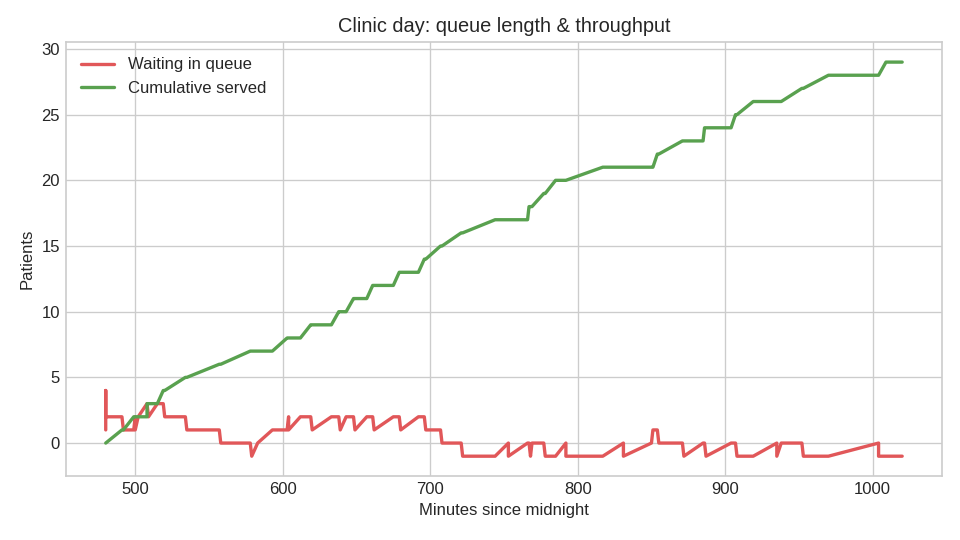
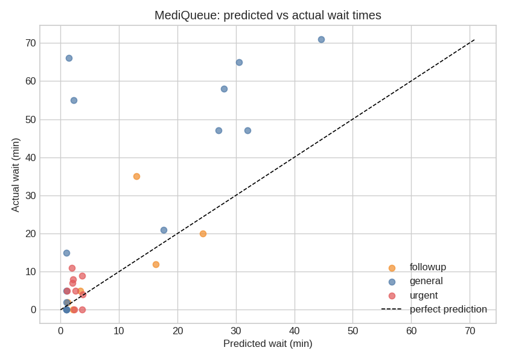

# MediQueue 🏥

[](requirements.txt)
[](#-running-it)
[](#-tech-stack)
[](#-why-un-sdg-3)
[](LICENSE)

> Clinic waiting rooms are chaos. **MediQueue** replaces the crowded waiting room
> with a virtual ticket queue, **ML-predicted wait times**, fair triage for urgent
> cases, and SMS-style "your turn is near" alerts — so patients wait *wherever
> they want*, not shoulder-to-shoulder in a lobby.

## 🎯 Problem

- Patients crowd waiting rooms for hours with **no idea** when they'll be seen.
- Urgent walk-ins disrupt the order — or get stuck behind routine visits.
- Clinics have **no data** on predicted vs. actual waits to improve staffing.

## 💡 Solution

MediQueue gives every patient a virtual ticket (`general` / `followup` / `urgent`),
predicts their wait with a trained regression model, serves them under **fair
triage rules**, and pings them shortly before their turn.

## ✨ Features

- **Virtual ticketing** — SQLite-backed queue; take a number by category.
- **ML wait-time prediction** — `RandomForestRegressor` trained on synthetic
  historical arrival/service data; predicts minutes-to-serve from live queue
  state + time of day.
- **Priority triage with fairness cap** — urgent cases jump the line, but at most
  **2 consecutive urgent bumps**, so general patients are never starved.
- **Simulated SMS/pager alerts** — patients are notified when their turn is
  ~10 minutes away.
- **Live dashboard** — auto-generated HTML dashboard + charts after every run.
- **Full-day clinic simulation** — arrivals, service, urgent walk-ins, with a
  predicted-vs-actual wait report at the end.

## 🚀 Demo

```bash
pip install -r requirements.txt
python3 -m mediqueue.cli demo        # full simulated clinic day
python3 -m mediqueue.cli demo --quiet  # skip the minute-by-minute timeline
```

Sample output:

```
08:00  Ticket T001 taken: arrival (general) | predicted wait 12 min
...
[SMS] -> patient T019 (followup): your turn in ~7 min (predicted wait was 3 min)
...
======================================================================
 Predicted vs actual wait comparison
======================================================================
 Patients served      : 29
 Avg predicted wait   : 9.4 min
 Avg actual wait      : 19.8 min
 Mean abs. error      : 11.8 min
 Max consec. urgent   : 2 (fairness cap = 2)
```

Open `screenshots/dashboard.html` after the demo for the visual dashboard.

## 🧪 Running it

```bash
TMPDIR=/tmp/pytest-tmp python3 -m pytest -q
# 18 passed — triage ordering + fairness cap, predictor sanity,
# DB lifecycle, and a full simulated clinic day with consistent stats
```

## 🛠 Tech stack

| Layer | Choice |
|---|---|
| Language | Python 3.12 (stdlib only for core) |
| ML model | **RandomForestRegressor** (n_estimators=200), scikit-learn |
| Features | queue counts per category, hour of day, ticket category |
| Storage | SQLite (in-memory for simulation; file-backed supported) |
| Viz | matplotlib (dashboard PNGs + HTML page) |
| Data | bundled synthetic history: `data/synthetic_history.csv` (4,000 rows, regenerable via `--regen-data`) |

100% offline — no API keys, no network calls.

## 📸 Screenshots

**Live queue dashboard** (auto-generated by the demo):




## 🗂 Project structure

```
mediqueue/
├── mediqueue/
│   ├── __init__.py
│   ├── cli.py        # `demo` command: full clinic-day simulation
│   ├── db.py         # SQLite-backed virtual ticket queue
│   ├── triage.py     # priority rules + fairness cap (max 2 consecutive urgent)
│   ├── predictor.py  # RandomForestRegressor training/prediction + synthetic data
│   ├── simulate.py   # clinic-day engine: arrivals, service, SMS alerts
│   └── dashboard.py  # matplotlib charts + HTML dashboard
├── tests/test_mediqueue.py   # 18 real tests
├── data/synthetic_history.csv  # bundled synthetic dataset (regenerable)
├── screenshots/      # hero banner + real demo outputs
├── requirements.txt
├── LICENSE
└── README.md
```

## 🗺 Roadmap

- [ ] Multi-doctor / multi-room scheduling
- [ ] Real SMS via Twilio (provider-agnostic notifier interface)
- [ ] Web UI (FastAPI + live dashboard instead of static HTML)
- [ ] Online learning: retrain the model on each clinic's real wait data
- [ ] No-show prediction to overbook safely

## 🌍 Why UN SDG 3

**SDG 3 — Good Health & Well-Being.** Long, crowded waits deter people from
seeking care and increase infection risk in waiting rooms. MediQueue cuts
unnecessary waiting-room time, prioritizes urgent cases fairly, and gives
clinics the wait-time data they need to serve more patients with the same staff.

## 📄 License

MIT — see [LICENSE](LICENSE).
